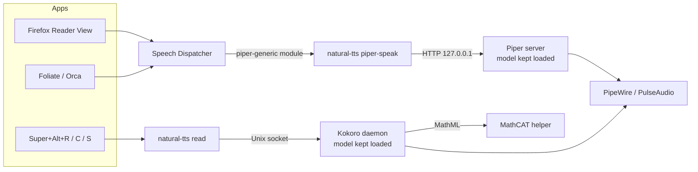

# Natural text-to-speech for Ubuntu

**Make your Linux desktop read aloud in a natural voice.** Highlight text in
any app and press a key, or let Firefox, e-book readers and screen readers
use a modern neural voice instead of the robotic default. Everything runs
locally: no account, no cloud, no text leaves your machine.

[](https://github.com/mahdi-shafiei/ubuntu-natural-tts/actions/workflows/ci.yml)
[](LICENSE)


## Quick start

```bash
git clone https://github.com/mahdi-shafiei/ubuntu-natural-tts.git
cd ubuntu-natural-tts
./install.sh            # add --gpu on NVIDIA machines for CUDA PyTorch
```

The installer downloads about 1.6 GB (PyTorch and the voice models) and
needs no logout. Then:

| Keys | Action |
|---|---|
| <kbd>Super</kbd>+<kbd>Alt</kbd>+<kbd>R</kbd> | Read the highlighted text |
| <kbd>Super</kbd>+<kbd>Alt</kbd>+<kbd>C</kbd> | Read the clipboard (press <kbd>Ctrl</kbd>+<kbd>C</kbd> first; needed in ONLYOFFICE and other canvas-based editors) |
| <kbd>Super</kbd>+<kbd>Alt</kbd>+<kbd>S</kbd> | Stop |

New text interrupts whatever is playing. In Firefox, open Reader View
(<kbd>F9</kbd>) and press the headphones button; the speed slider works.

If something stays silent, run `natural-tts doctor`.

## Hear the difference

The same sentence, read by each engine. Press play on each:

**espeak-ng**: what Linux uses out of the box

https://github.com/user-attachments/assets/4be1daea-9db4-4fcf-bbb6-1e283f1394a0

**Piper**: the natural-tts system voice

https://github.com/user-attachments/assets/6413770f-cfbd-47a1-9619-37454c34ae6d

**Kokoro**: the natural-tts read-anything hotkey

https://github.com/user-attachments/assets/07156e2c-69fa-446a-9be4-e507cbc39142

| | espeak-ng | Piper | Kokoro-82M |
|---|---|---|---|
| **Sound** | Robotic, formant synthesis | Natural, neural (VITS) | Most natural, neural (StyleTTS 2) |
| **Role here** | Ubuntu's default, replaced | System voice via Speech Dispatcher | Read-anything hotkey |
| **Used by** | Every Speech Dispatcher client | Firefox Reader View, Foliate, Orca | Any app with selectable text |
| **Runs on** | Any CPU | Any CPU, faster than real time | CPU; NVIDIA GPU optional |
| **Model size** | None | About 110 MB per voice | 82M parameters |
| **License** | GPL-3.0 | GPL-3.0 engine; voice license varies | Apache-2.0 |
| **Listen** | [espeak.mp3](docs/samples/espeak.mp3) | [piper.mp3](docs/samples/piper.mp3) | [kokoro.mp3](docs/samples/kokoro.mp3) |

## Features

- **Natural voices, locally.** Kokoro for the hotkeys, Piper as the
  system-wide [Speech Dispatcher](https://github.com/brailcom/speechd)
  voice. CPU is enough; an NVIDIA GPU is optional.
- **Works in every app.** Highlighted text (X11 and Wayland), the
  clipboard, or any program that speaks through Speech Dispatcher.
- **Reads PDFs properly.** Words hyphenated across line breaks are
  re-joined and hard wraps removed before speaking.
- **Reads like a person.** Numbers, dates, units, abbreviations and
  symbols are spoken as words: `p < 0.05` is "p is less than zero point
  zero five", `Fig. 3` is "Figure three", `E. coli` is pronounced
  correctly, `[12]` citation markers are skipped. Company and product
  names are read whole, initialisms as one smooth word, IEEE as "I triple
  E". Your own pronunciations go in `~/.config/natural-tts/lexicon.toml`.
- **Reads structure and code.** Headings, lists, quotes and tables get
  their own pauses; a table is read caption first, then each row as
  "Heading. Column: value." sentences; code blocks in Markdown, HTML,
  reStructuredText, LaTeX, Org, AsciiDoc, prompts and diffs are read as
  words (`get_user_name(x)` is "get user name x"), with `code_level`
  choosing how much punctuation you hear.
- **Reads math the way a lecturer says it.** LaTeX, Unicode formulas and
  MathML on web pages go through [MathCAT](https://nsoiffer.github.io/MathCAT/)
  after the formula is annotated with what it means: `P(A \mid B)` is
  "probability of A given B", `E[X]` "expected value of X", `A^{-1}` "A
  inverse", `\frac{a}{b}` "a over b", `e^{-x^2}` "e to the negative x
  squared", `\int_0^1 f(x)\,dx` "the integral from 0 to 1 of f of x d x".
- **Reads science notation.** Compounds are named in prose (`CO2` is
  "carbon dioxide") and spelled in equations; gene variants, karyotypes,
  genotypes, restriction enzymes and cell lines follow the nomenclature
  standards and the way practitioners say them; units use NIST's spoken
  names.
- **Fast start, instant stop.** Speech starts after the first short chunk;
  stop takes effect within about a tenth of a second.
- **Self-healing.** Audio-device or synthesis errors are logged and
  recovered from; services restart automatically.
- **One settings file.** Change voices and speeds in
  `~/.config/natural-tts/settings.toml`, then run `natural-tts apply`.
- **Leaves your system alone.** Your other Speech Dispatcher voices and
  GNOME shortcuts are kept; `natural-tts teardown` reverts every change.
- **Private.** Nothing is sent anywhere; the Piper server listens on
  127.0.0.1 only.

## What it sounds like

Each clip plays the same selection twice: the raw reading first, then
natural-tts. Ticks mark where the text was cut into speech.

### Prose

**Numbers, units and symbols** in a methods sentence:

> We used a phosphate buffered saline solution at pH 7.4 and 37 °C
> (n = 3; p < 0.05), see Eq. 2: x = 1.


https://github.com/user-attachments/assets/13c415b6-30db-43bb-b606-b5bb1e233d87


**Abbreviations and names**:

> Our neighbour, Dr. Ana Ruiz, moved to St. Paul last spring; her
> brother, Mr. T. Ruiz, stayed behind.


https://github.com/user-attachments/assets/105e4e63-ce28-4e53-863e-1e195562aa34


<details>
<summary>Two more: a paper sentence and a citation-heavy one</summary>

> In E. coli the gene lacZ is expressed, as Dr. Smith et al. showed in
> Fig. 3 of the paper, which we read in detail.


https://github.com/user-attachments/assets/4de64001-b591-40fc-a225-a23f3bcbfa55


> The effect was first reported by Chen et al. in 2019 (see Ref. 4;
> cf. Sec. 3.2), and later confirmed, e.g. by Müller et al., with
> larger samples (n = 120; p < 0.01).


https://github.com/user-attachments/assets/789baf62-d685-4d0d-9a0a-da9d1c0647e7


</details>

| Written | Spoken |
|---|---|
| `p < 0.05`, `n = 3`, `5 ± 2` | p is less than zero point zero five, n equals three, five plus or minus two |
| `37 °C`, `10 µg/mL`, `3–5 mm` | thirty-seven degrees Celsius, ten micrograms per milliliter, three to five millimeters |
| `Fig. 3`, `Eq. 2`, `et al.`, `e.g.` | Figure three, Equation two, et al, for example |
| `Dr. Smith`, `St. Louis`, `Elm St.` | Doctor Smith, Saint Louis, Elm Street |
| `2026-10-21`, `14:30`, `$5.50`, `v2.1.0` | October twenty-first, twenty twenty-six; fourteen thirty; five dollars and fifty cents; version two point one point zero |
| `70B`, `12k users`, `$18.5M` | seventy billion, twelve thousand users, eighteen point five million dollars |
| `LinkedIn`, `PyTorch`, `ODE`, `GPUs`, `IEEE` | read whole by the engine; O D E as one word; G P Us; I triple E |
| `E. coli`, `in vitro`, `Cas9`, `CO2` | pronounced from the built-in lexicon; carbon dioxide |
| `[12]`, `(Smith et al., 2019)` | skipped (`citations = "read"` says them) |

Every rule is plain code in `src/natural_tts/reading/`, and
`reading.enabled = false` restores the raw reading.

### Structure and code

**A README fragment** with a heading, a list and a table:

```markdown
## Quick start

Run the installer, then press a key:

- Super+Alt+R reads the highlighted text
- Super+Alt+C reads the clipboard

| Key | Action |
|---|---|
| Super+Alt+S | stop |
```


https://github.com/user-attachments/assets/96b9609a-6863-49bc-8433-bda4d9025f98


**A Python block** at `code_level = 1`:

```python
def get_user_name(users, idx):
    # the first match wins
    if idx >= len(users):
        return None
    return users[idx].name
```


https://github.com/user-attachments/assets/948609bc-0772-4764-8f97-f25dc3e93ca5


**An HTML selection**, as Firefox hands it over:

```html
<h2>Results</h2>
<p>Run <code>git add -A</code> at 37 °C, see Fig. 3.</p>
<ol><li>mix the buffer</li><li>incubate for 2 h</li></ol>
```


https://github.com/user-attachments/assets/41a6809b-6c8b-4a85-beda-5718b5203ff1


### Math

**Inline formulas in a sentence**, as a paper source carries them:

```latex
We model the posterior as $P(\theta \mid D) = \frac{P(D \mid \theta)\, P(\theta)}{P(D)}$
and fit $\hat{y} = \beta_0 + \beta_1 x$, which is significant at $p < 0.05$.
```


https://github.com/user-attachments/assets/3aca0af4-e711-4c56-b03f-40c01981a542


**A display formula** between paragraphs:

```latex
The Gaussian integral

$$\int_{-\infty}^{\infty} e^{-x^2}\,dx = \sqrt{\pi}$$

follows from polar coordinates.
```


https://github.com/user-attachments/assets/bac34e82-d57f-4c80-a253-c441b13ae0b1


**A formula line from a PDF**, in plain Unicode:

```text
Energy is given by

E = mc²

where m is the mass, and x² + y² = r² describes a circle.
```


https://github.com/user-attachments/assets/88efb6a4-6564-43b6-b853-96e2169632ee


## How it works



- **Piper** handles Speech Dispatcher because it starts in well under a
  second per sentence. Its model stays loaded in a localhost-only HTTP
  server (a `systemd --user` service).
- **Kokoro** sounds more natural but takes a few seconds to load, so it
  runs as a background daemon. Hotkeys send it text over a private Unix
  socket.
- **The reading front end** turns a selection into speakable segments
  before Kokoro sees it: it finds the structure (headings, lists, tables,
  code, formulas), rewrites numbers, units, abbreviations and notation
  into words, and applies the lexicon.
- **MathCAT** speaks formulas. The daemon starts `natural-tts-mathcat`
  (a helper built from the MathCAT crate, downloaded by `setup`) once and
  sends it MathML annotated with the formula's meaning; its answer, with
  pauses and spelled letters, becomes the spoken segment.
- Both services and the Speech Dispatcher configuration are generated from
  the single `settings.toml`.

## Configuration

`~/.config/natural-tts/settings.toml` (created by `setup`):

```toml
[piper]
voice = "en_US-ljspeech-high"  # system voice
length_scale = 1.05            # higher is slower
sentence_silence = 0.25        # pause after each sentence, seconds
port = 5150

[kokoro]
voice = "af_heart"             # hotkey voice
speed = 1.0                    # 0.5 .. 2.0

[reading]
enabled = true                 # speak numbers, units, abbreviations and
                               # symbols as words (English voices only)
citations = "skip"             # or "read": citation markers such as [12]
code_level = 1                 # code blocks: 1 operators, 2 adds brackets
                               # and indentation, 3 every symbol
math_style = "clearspeak"      # or "simplespeak": how formulas are read
```

Run `natural-tts apply` after editing. A new Piper voice is downloaded
automatically.

Pronunciations the engine gets wrong go in
`~/.config/natural-tts/lexicon.toml`, which is merged over the built-in
list on the next `apply`. Phonemes use Kokoro's alphabet (`A` = ay,
`I` = eye, `O` = oh; `ˈ` marks stress); `words` replaces text instead:

```toml
[[entry]]
head = "Zymomonas"
misaki = "zˌImOmˈOnəs"

[[entry]]
head = "ACS"          # said as a word, not spelled
match = "exact"
misaki = "ˈæks"

[[entry]]
head = "IEEE"
match = "exact"
words = "I triple E"
```

### Voices

Kokoro voices, with the quality grades from its
[voice list](https://huggingface.co/hexgrad/Kokoro-82M/blob/main/VOICES.md):

| Voice | Grade | |
|---|---|---|
| `af_heart` | A | US English, female (default) |
| `af_bella` | A- | US English, female |
| `af_nicole` | B- | US English, female, soft |
| `bf_emma` | B- | British English, female |
| `am_michael`, `am_fenrir`, `am_puck` | C+ | US English, male |
| `bm_fable`, `bm_george` | C | British English, male |

Piper voices: listen at
[rhasspy.github.io/piper-samples](https://rhasspy.github.io/piper-samples/)
and prefer `high` quality. **Check the dataset license** in each voice's
model card. The default `en_US-ljspeech-high` and `en_GB-cori-high` are
trained on public-domain data; the popular `en_US-lessac-high` uses a
research-only dataset and `en_US-ryan-high` a non-commercial one.

Other languages work too: Piper has voices for about 40 languages, and
Kokoro covers English, Spanish, French, Hindi, Italian, Japanese,
Portuguese and Mandarin. The structure reading works with every Kokoro
voice; the English word rules run only for English voices, and MathCAT
speaks formulas in Spanish, French, Portuguese and Chinese for those
voices.

## Commands

| Command | Purpose |
|---|---|
| `natural-tts setup` | Configure services, Speech Dispatcher and hotkeys; install the MathCAT helper |
| `natural-tts apply` | Apply `settings.toml` and restart services |
| `natural-tts doctor` | Check every component and print fixes |
| `natural-tts read selection` / `read clipboard` | Read aloud (what the hotkeys run) |
| `natural-tts say "text"` | Read text, or stdin, aloud |
| `natural-tts stop` | Stop reading |
| `natural-tts teardown` | Remove services, config changes and hotkeys |
| `./install.sh --uninstall` | Remove everything except settings |

## Troubleshooting

Start with:

```bash
natural-tts doctor
```

Each failing check prints the command that fixes it. Common cases:

| Symptom | Cause and fix |
|---|---|
| Hotkey does nothing right after login | Kokoro takes 10–20 s to load; a notification says so. Wait, or check `journalctl --user -u natural-tts-kokoro.service` for `natural-tts ready`. |
| Hotkey reads old text | The app never set the highlight (ONLYOFFICE, some Electron apps). Press <kbd>Ctrl</kbd>+<kbd>C</kbd>, then <kbd>Super</kbd>+<kbd>Alt</kbd>+<kbd>C</kbd>. |
| Firefox shows no natural voice | Fully quit and reopen Firefox after setup. The snap version works through `speech-dispatcher.socket`. |
| Only `piper-generic` is listed by `spd-say -O` | An active `AddModule` line in `~/.config/speech-dispatcher/speechd.conf` disables auto-detection; comment it out. |
| No sound at all | `doctor` checks that ALSA is routed to your sound server. On PipeWire the fix is `pipewire-alsa`; on PulseAudio it is `libasound2-plugins` (never install `pipewire-alsa` there: it replaces PulseAudio). |
| Gaps between sentences | Synthesis is slower than playback on this CPU. Reinstall with `./install.sh --gpu` on NVIDIA machines, or raise `kokoro.speed`. |
| Speech stopped after unplugging headphones | Errors are recovered automatically on the next request; if not, `systemctl --user restart natural-tts-kokoro.service`. |
| Hotkeys gone from Settings > Keyboard | `doctor` reports them missing; `natural-tts setup` adds them back without touching anything else. |
| "daemon is not running or still starting" right after an upgrade | `setup` restarts the daemon and the old socket file lingers for a few seconds. Wait for `natural-tts ready` in `journalctl --user -u natural-tts-kokoro.service`, then try again. |
| A number, unit, date or abbreviation is read in a way you do not want | The reading rules are plain code in `src/natural_tts/reading/`; `reading.enabled = false` in `settings.toml` restores the raw reading, and `reading.citations = "read"` says citation markers. Open an issue with the sentence and what you expected. |
| A name or term is mispronounced | Add it to `~/.config/natural-tts/lexicon.toml` (see [Configuration](#configuration)) and run `natural-tts apply`. Company and product names are read by the engine as written, so an entry with `match = "exact"` and the phonemes (or `words`) fixes one name without touching others. |
| A company name is spelled letter by letter, or an acronym is read as a word | Four-letter-and-longer capital runs are the engine's call: it spells what it does not know (TSMC, ASML) and reads the words it knows (NASA, COVID). Add an entry with `words` or phonemes for the exceptions (`SUSE`, `WHOOP` are packaged). Two- and three-letter runs are always spelled unless listed as words. |
| A table is read cell by cell with its headers and you would rather hear less | Every cell is read as "Column: value." so that long and wide tables stay followable; the caption and the shape come first and "End of table" closes it. There is no setting to shorten it yet; open an issue with the table. |
| Code is read with too much or too little punctuation | `reading.code_level` is 1 (operators only), 2 (adds brackets, separators and indentation) or 3 (every symbol). |
| A web page's headings and lists are read as one paragraph | Only Firefox puts the selection's HTML on the clipboard; Chromium-based browsers hand over plain text, so structure is recognised there only from Markdown markers. Copying with <kbd>Ctrl</kbd>+<kbd>C</kbd> and pressing <kbd>Super</kbd>+<kbd>Alt</kbd>+<kbd>C</kbd> can help, since the copy clipboard often carries HTML. |
| A formula is read as a jumble of words, or `doctor` says the Math helper is missing | `natural-tts apply` downloads the release's MathCAT helper (`~/.local/share/natural-tts/bin/natural-tts-mathcat`). Offline, or on a platform without a binary, build it: `natural-tts setup --helper-source /path/to/clone/helper/mathcat` (needs `cargo`). Until then formulas are read as words. |
| A formula is spoken in a way you do not want | `reading.math_style = "simplespeak"` is shorter; see the known limits under [FAQ](#faq). Formulas with unbalanced delimiters are read as words. "Divides" for a conditional bar, "cap p" or "raised to the … power" mean a helper or package older than the current release: run `natural-tts apply`. |
| Upgrading left the old behaviour running | `./install.sh` restarts the services; `natural-tts apply` does too. |

Logs: `journalctl --user -u natural-tts-kokoro.service` and
`journalctl --user -u natural-tts-piper.service`.

## FAQ

**How do I make text-to-speech on Linux sound natural?**
Replace the default espeak voice with a neural one. This project sets up
Piper as the system-wide Speech Dispatcher voice and Kokoro for a
read-anything hotkey, in one command.

**Why does Firefox "read aloud" sound robotic on Ubuntu?**
Firefox Reader View speaks through Speech Dispatcher, which uses espeak-ng
by default. After `./install.sh`, it uses Piper instead.

**Does it work offline? Is my text sent anywhere?**
After installation everything runs offline and on your machine. The
installer downloads the models once.

**Do I need a GPU?**
No. Kokoro is an 82M-parameter model and runs on a desktop CPU. With an
NVIDIA GPU, `./install.sh --gpu` uses CUDA.

**Does it work on Wayland? On KDE or other distributions?**
Wayland and X11 both work. Hotkeys are added automatically on GNOME;
on other desktops, bind `natural-tts read selection`, `natural-tts read
clipboard` and `natural-tts stop` in your keyboard settings. The installer
uses apt; other distributions need the equivalent packages.

**Can I use a different voice or language?**
Yes, see [Configuration](#configuration).

**Why does it say "Figure three" when the text says "Fig. 3"?**
Because that is what a person reading aloud says. The hotkey rewrites
numbers, dates, units, abbreviations and symbols into words before Kokoro
sees them, so `p < 0.05` is "p is less than zero point zero five" rather
than silence for the `<`. Everything is a readable rule; set
`reading.enabled = false` to hear the raw text instead.

**How do I fix the pronunciation of a word?**
Put it in `~/.config/natural-tts/lexicon.toml` with Kokoro's phonemes or a
`words` replacement (examples in [Configuration](#configuration)) and run
`natural-tts apply`. The built-in list covers common species names,
Latin phrases, gene and method names, and company names the engine
misreads.

**How are company names, product names and acronyms read?**
As the speech engine reads them. Camel-case names (LinkedIn, GitHub,
PyTorch, OpenAI) and mixed tokens (mRNA, HbA1c, p53) go to the engine
whole; it looks the cased spelling up, splits what it does not know and
reads each half, so no list of brands is needed. Two- and three-letter
capital runs (ODE, DNA, GPU, US) are spelled as one word with the stress
on the last letter, the engine's own convention; longer runs are the
engine's: it spells what it does not know and says the acronyms it knows
as words (NASA, COVID, CRISPR). Mixed readings need an entry: IEEE ("I
triple E") and the company names the engine misreads are packaged, and
your lexicon file takes the rest. SQL stays "sequel". A sentence or
heading written in capitals is read as words.

**How is code read?**
Identifiers are split into words (`get_user_name` is "get user name"),
numbers are spoken, strings and comments are read as words, and operators
by name. `reading.code_level` decides how much punctuation you hear. Code
is recognised in Markdown, HTML, reStructuredText, LaTeX, Org, AsciiDoc,
shell transcripts, Python prompts, diffs and plain indented code. The code
voice is the reading voice.

**How are tables read?**
Caption first, then "Table with 3 rows and 3 columns", the column names
once, each row as "Row heading. Column: value. Column: value." with
"blank" for an empty cell, and "End of table". Rows get a longer pause
than cells. This follows the published listening study of spoken tables
(header-value pairs with a pause hierarchy) and what NVDA reads in say-all
mode; two-row headers are joined ("Score, Dev"), spanning cells repeat
their value, and a Markdown table's first column names the row.

**Does it read math?**
Yes, the way a lecturer would say it. LaTeX between `$…$`, `$$…$$`,
`\(…\)`, `\[…\]` or in `equation`, `align` and similar environments,
Unicode formulas on their own line (`E = mc²`, as PDFs paste them), and
MathML on web pages (Firefox hands it over) are converted to MathML and
spoken by [MathCAT](https://nsoiffer.github.io/MathCAT/) in ClearSpeak, the
style students understood best in the published comparison. Before
MathCAT sees it, the formula is annotated with what it means, using the
W3C MathML intent vocabulary: `P(A \mid B)` is "probability of A given B",
`E[X]` "expected value of X", `\operatorname{Var}(X)` "variance of X",
`X^T` "X transpose", `A^{-1}` "A inverse", `X \sim N(\mu,\sigma^2)` "X is
distributed as N of mu, sigma squared", `f(x, y)` "f of x, y",
`\arg\max_\theta` "arg max over theta of", `\nabla \cdot E` "the
divergence of E", `|\psi\rangle` "ket psi". Capitals are not announced,
fractions are "a over b" with "end fraction" only when nested, `e^{-x^2}`
is "e to the negative x squared", `\ln` is "natural log".
`reading.math_style = "simplespeak"` is terser. Short fragments inside
prose such as `x²`, `5 ± 2` or `p < 0.05` keep the word rules. Known
limits: the set-builder bar in `\{x \mid x > 2\}` is "divides",
`\mathbb{R}^n` is "the real numbers to the n-th power", a two-sided Dirac
bracket `\langle\phi|\psi\rangle` is read as its contents ("phi psi")
because its meaning depends on context, and `KL(p \| q)` is "K L
divergence from p to q". Dollar amounts (`$5 and $10`) and shell variables
are never taken for formulas.

**Does it read chemistry, biology and physics notation?**
Common compounds are named in prose ("carbon dioxide", "sulfuric acid",
"glucose") and spelled inside equations, which is how chemists read them.
Gene variants follow the HGVS segments ("c dot one twenty-three, A to G",
"p dot arg one seventy-five his"), karyotypes the ISCN ones ("forty-six,
X Y, translocation between nine and twenty-two…"), genotypes say
"knockout" and "heterozygous", restriction enzymes "Eco R one", cell
lines "HEK two ninety-three", and dosing abbreviations their written
replacements ("twice daily", "by mouth"). Units use NIST's spoken names
("five kilopascals", "three hundred kelvins", "millimeters of mercury");
`ħ` is "h bar". The conventions and their sources are listed in the
[changelog](CHANGELOG.md); what no source settles is marked as a project
decision there.

**What is the MathCAT helper?**
A 5 MB program, `natural-tts-mathcat`, built from the MathCAT Rust crate
with its speech rules embedded, started once by the daemon and kept
running. `setup` downloads it from this project's release for your
architecture and checks its SHA-256; `doctor` shows its version.

**Can I skip citation markers like [12] or (Smith et al., 2019)?**
They are skipped by default; `reading.citations = "read"` says them.

**How do I uninstall?**
`./install.sh --uninstall` removes services, configuration changes and
installed files. Settings in `~/.config/natural-tts` are kept.

## Development

```bash
uv venv --python 3.12 && uv pip install -e ".[dev]"
uv run pre-commit install
uv run pytest                      # unit tests with a coverage gate
dbus-run-session -- uv run pytest -m integration   # real gsettings
```

The code is test-driven, strictly typed (mypy `--strict`) and formatted
with ruff. All system access goes through small injectable interfaces, so
the unit tests run without audio hardware, Kokoro or a desktop session.
The spoken forms are pinned by golden files (`tests/reading/*.tsv`), one
row per behaviour with its source. See [CONTRIBUTING.md](CONTRIBUTING.md)
and the [changelog](CHANGELOG.md) for the history.

## Credits

- [Kokoro-82M](https://huggingface.co/hexgrad/Kokoro-82M) by hexgrad (Apache-2.0)
- [Piper](https://github.com/OHF-Voice/piper1-gpl) by the Open Home Foundation (GPL-3.0-or-later)
- [MathCAT](https://github.com/NSoiffer/MathCAT) by Neil Soiffer (MIT)
- [Speech Dispatcher](https://github.com/brailcom/speechd) (GPL-2.0-or-later)

natural-tts itself is released under the [MIT license](LICENSE).
