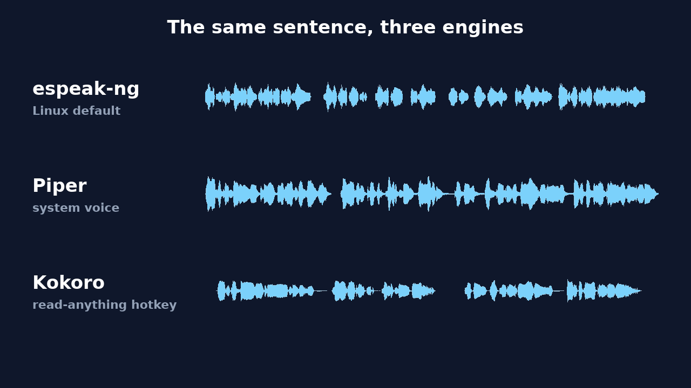
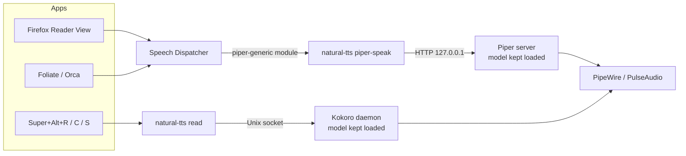

# Natural text-to-speech for Ubuntu

**Make your Linux desktop read aloud in a natural voice.** Highlight text in
any app and press a key, or let Firefox, e-book readers and screen readers
use a modern neural voice instead of the robotic default. Everything runs
locally: no account, no cloud, no text leaves your machine.

[](https://github.com/mahdi-shafiei/ubuntu-natural-tts/actions/workflows/ci.yml)
[](LICENSE)


## Hear the difference

The same sentence, read by each engine in turn:

<!-- Video: media/comparison.mp4 from scripts/render_comparison.py. GitHub
     plays only videos uploaded through its editor: drag the file onto this
     line on github.com. -->



| | espeak-ng | Piper | Kokoro-82M |
|---|---|---|---|
| **Sound** | Robotic, formant synthesis | Natural, neural (VITS) | Most natural, neural (StyleTTS 2) |
| **Role here** | Ubuntu's default, replaced | System voice via Speech Dispatcher | Read-anything hotkey |
| **Used by** | Every Speech Dispatcher client | Firefox Reader View, Foliate, Orca | Any app with selectable text |
| **Runs on** | Any CPU | Any CPU, faster than real time | CPU; NVIDIA GPU optional |
| **Model size** | None | About 110 MB per voice | 82M parameters |
| **License** | GPL-3.0 | GPL-3.0 engine; voice license varies | Apache-2.0 |
| **Listen** | [espeak.mp3](docs/samples/espeak.mp3) | [piper.mp3](docs/samples/piper.mp3) | [kokoro.mp3](docs/samples/kokoro.mp3) |

## Quick start

```bash
git clone https://github.com/mahdi-shafiei/ubuntu-natural-tts.git
cd ubuntu-natural-tts
./install.sh            # add --gpu on NVIDIA machines for CUDA PyTorch
```

The installer downloads about 1.6 GB (PyTorch and the voice models) and
needs no logout. Then:

| Keys | Action |
|---|---|
| <kbd>Super</kbd>+<kbd>Alt</kbd>+<kbd>R</kbd> | Read the highlighted text |
| <kbd>Super</kbd>+<kbd>Alt</kbd>+<kbd>C</kbd> | Read the clipboard (press <kbd>Ctrl</kbd>+<kbd>C</kbd> first; needed in ONLYOFFICE and other canvas-based editors) |
| <kbd>Super</kbd>+<kbd>Alt</kbd>+<kbd>S</kbd> | Stop |

New text interrupts whatever is playing. In Firefox, open Reader View
(<kbd>F9</kbd>) and press the headphones button; the speed slider works.

If something stays silent, run `natural-tts doctor`.

## Features

- **Natural voices, locally.** Kokoro for the hotkeys, Piper as the
  system-wide [Speech Dispatcher](https://github.com/brailcom/speechd)
  voice. CPU is enough; an NVIDIA GPU is optional.
- **Works in every app.** Highlighted text (X11 and Wayland), the
  clipboard, or any program that speaks through Speech Dispatcher.
- **Reads PDFs properly.** Words hyphenated across line breaks are
  re-joined and hard wraps removed before speaking.
- **Fast start, instant stop.** Speech starts after the first short chunk;
  stop takes effect within about a tenth of a second.
- **Self-healing.** Audio-device or synthesis errors are logged and
  recovered from; services restart automatically.
- **One settings file.** Change voices and speeds in
  `~/.config/natural-tts/settings.toml`, then run `natural-tts apply`.
- **Leaves your system alone.** Your other Speech Dispatcher voices and
  GNOME shortcuts are kept; `natural-tts teardown` reverts every change.
- **Private.** Nothing is sent anywhere; the Piper server listens on
  127.0.0.1 only.

## How it works



- **Piper** handles Speech Dispatcher because it starts in well under a
  second per sentence. Its model stays loaded in a localhost-only HTTP
  server (a `systemd --user` service).
- **Kokoro** sounds more natural but takes a few seconds to load, so it
  runs as a background daemon. Hotkeys send it text over a private Unix
  socket.
- Both services and the Speech Dispatcher configuration are generated from
  the single `settings.toml`.

## Configuration

`~/.config/natural-tts/settings.toml` (created by `setup`):

```toml
[piper]
voice = "en_US-ljspeech-high"  # system voice
length_scale = 1.05            # higher is slower
sentence_silence = 0.25        # pause after each sentence, seconds
port = 5150

[kokoro]
voice = "af_heart"             # hotkey voice
speed = 1.0                    # 0.5 .. 2.0
```

Run `natural-tts apply` after editing. A new Piper voice is downloaded
automatically.

### Voices

Kokoro voices, with the quality grades from its
[voice list](https://huggingface.co/hexgrad/Kokoro-82M/blob/main/VOICES.md):

| Voice | Grade | |
|---|---|---|
| `af_heart` | A | US English, female (default) |
| `af_bella` | A- | US English, female |
| `af_nicole` | B- | US English, female, soft |
| `bf_emma` | B- | British English, female |
| `am_michael`, `am_fenrir`, `am_puck` | C+ | US English, male |
| `bm_fable`, `bm_george` | C | British English, male |

Piper voices: listen at
[rhasspy.github.io/piper-samples](https://rhasspy.github.io/piper-samples/)
and prefer `high` quality. **Check the dataset license** in each voice's
model card. The default `en_US-ljspeech-high` and `en_GB-cori-high` are
trained on public-domain data; the popular `en_US-lessac-high` uses a
research-only dataset and `en_US-ryan-high` a non-commercial one.

Other languages work too: Piper has voices for about 40 languages, and
Kokoro covers English, Spanish, French, Hindi, Italian, Japanese,
Portuguese and Mandarin.

## Commands

| Command | Purpose |
|---|---|
| `natural-tts setup` | Configure services, Speech Dispatcher and hotkeys |
| `natural-tts apply` | Apply `settings.toml` and restart services |
| `natural-tts doctor` | Check every component and print fixes |
| `natural-tts read selection` / `read clipboard` | Read aloud (what the hotkeys run) |
| `natural-tts say "text"` | Read text, or stdin, aloud |
| `natural-tts stop` | Stop reading |
| `natural-tts teardown` | Remove services, config changes and hotkeys |
| `./install.sh --uninstall` | Remove everything except settings |

## Troubleshooting

Start with:

```bash
natural-tts doctor
```

Each failing check prints the command that fixes it. Common cases:

| Symptom | Cause and fix |
|---|---|
| Hotkey does nothing right after login | Kokoro takes 10–20 s to load; a notification says so. Wait, or check `journalctl --user -u natural-tts-kokoro.service` for `natural-tts ready`. |
| Hotkey reads old text | The app never set the highlight (ONLYOFFICE, some Electron apps). Press <kbd>Ctrl</kbd>+<kbd>C</kbd>, then <kbd>Super</kbd>+<kbd>Alt</kbd>+<kbd>C</kbd>. |
| Firefox shows no natural voice | Fully quit and reopen Firefox after setup. The snap version works through `speech-dispatcher.socket`. |
| Only `piper-generic` is listed by `spd-say -O` | An active `AddModule` line in `~/.config/speech-dispatcher/speechd.conf` disables auto-detection; comment it out. |
| No sound at all | `doctor` checks that ALSA is routed to your sound server. On PipeWire the fix is `pipewire-alsa`; on PulseAudio it is `libasound2-plugins` (never install `pipewire-alsa` there: it replaces PulseAudio). |
| Gaps between sentences | Synthesis is slower than playback on this CPU. Reinstall with `./install.sh --gpu` on NVIDIA machines, or raise `kokoro.speed`. |
| Speech stopped after unplugging headphones | Errors are recovered automatically on the next request; if not, `systemctl --user restart natural-tts-kokoro.service`. |

Logs: `journalctl --user -u natural-tts-kokoro.service` and
`journalctl --user -u natural-tts-piper.service`.

## FAQ

**How do I make text-to-speech on Linux sound natural?**
Replace the default espeak voice with a neural one. This project sets up
Piper as the system-wide Speech Dispatcher voice and Kokoro for a
read-anything hotkey, in one command.

**Why does Firefox "read aloud" sound robotic on Ubuntu?**
Firefox Reader View speaks through Speech Dispatcher, which uses espeak-ng
by default. After `./install.sh`, it uses Piper instead.

**Does it work offline? Is my text sent anywhere?**
After installation everything runs offline and on your machine. The
installer downloads the models once.

**Do I need a GPU?**
No. Kokoro is an 82M-parameter model and runs on a desktop CPU. With an
NVIDIA GPU, `./install.sh --gpu` uses CUDA.

**Does it work on Wayland? On KDE or other distributions?**
Wayland and X11 both work. Hotkeys are added automatically on GNOME;
on other desktops, bind `natural-tts read selection`, `natural-tts read
clipboard` and `natural-tts stop` in your keyboard settings. The installer
uses apt; other distributions need the equivalent packages.

**Can I use a different voice or language?**
Yes, see [Configuration](#configuration).

**How do I uninstall?**
`./install.sh --uninstall` removes services, configuration changes and
installed files. Settings in `~/.config/natural-tts` are kept.

## Development

```bash
uv venv --python 3.12 && uv pip install -e ".[dev]"
uv run pre-commit install
uv run pytest                      # unit tests with a coverage gate
dbus-run-session -- uv run pytest -m integration   # real gsettings
```

The code is test-driven, strictly typed (mypy `--strict`) and formatted
with ruff. All system access goes through small injectable interfaces, so
the unit tests run without audio hardware, Kokoro or a desktop session.
See [CONTRIBUTING.md](CONTRIBUTING.md).

## Credits

- [Kokoro-82M](https://huggingface.co/hexgrad/Kokoro-82M) by hexgrad (Apache-2.0)
- [Piper](https://github.com/OHF-Voice/piper1-gpl) by the Open Home Foundation (GPL-3.0-or-later)
- [Speech Dispatcher](https://github.com/brailcom/speechd) (GPL-2.0-or-later)

natural-tts itself is released under the [MIT license](LICENSE).
